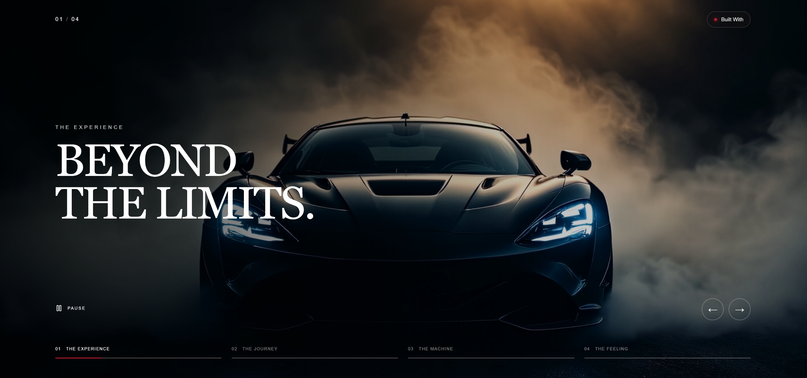

# NOIR MOTION

A cinematic automotive video slider built as a frontend showcase project.

The experience combines fullscreen automotive footage, animated typography, smooth scene transitions and intuitive navigation in a dark, minimalist interface inspired by premium automotive campaigns.



> This is an independent concept project created for educational and portfolio purposes. It is not affiliated with, endorsed by, or associated with any automotive manufacturer. All automotive footage and imagery remain the property of their respective owners.

## Live Demo

[https://mirekzverina-video-slider.netlify.app/](https://mirekzverina-video-slider.netlify.app/)

## Features

- Interactive four-scene cinematic video slider
- Fullscreen automotive video backgrounds
- Animated typography powered by Motion
- Smooth scene transitions
- Automatic slide progression with visual progress indicators
- Play and pause controls
- Previous and next slide navigation
- Keyboard and touch swipe navigation
- Responsive design for desktop, tablet and mobile
- Interactive Built With panel
- Open Graph metadata for social sharing

## Tech Stack

- React
- TypeScript
- Vite
- SCSS
- Motion
- Lucide React
- React Icons

## Getting Started

Clone the repository and install the dependencies:

```bash
npm install
```

Start the development server:

```bash
npm run dev
```

Create a production build:

```bash
npm run build
```

## Project Structure

```text
public/
├── videos/
│   ├── experience.mp4
│   ├── journey.mp4
│   ├── machine.mp4
│   └── feeling.mp4
├── favicon.png
└── social-preview.png

src/
├── components/
│   ├── VideoSlider.tsx
│   ├── VideoSlide.tsx
│   ├── SlideNavigation.tsx
│   ├── VideoControls.tsx
│   └── TechStack.tsx
├── data/
│   └── slides.ts
├── styles/
│   ├── _variables.scss
│   ├── _reset.scss
│   └── main.scss
├── App.tsx
└── main.tsx
```

## Design

The project focuses on an immersive, cinematic automotive experience with:

- fullscreen video storytelling
- dark, high-contrast visual aesthetics
- elegant serif typography
- minimal navigation and interface elements
- subtle red accents and translucent controls
- fluid animations and responsive compositions

Each scene introduces a different perspective on the automotive experience while maintaining a consistent visual identity.

## Accessibility

The interface includes keyboard navigation, interactive playback controls and responsive layouts across desktop, tablet and mobile devices.

## Author

**Mirek Zvěřina**  
Full-Stack Developer

Portfolio: [https://mirekzverina.netlify.app/](https://mirekzverina.netlify.app/)  
GitHub: [https://github.com/mirekzverina](https://github.com/mirekzverina)  
LinkedIn: [https://linkedin.com/in/mirekzverina](https://linkedin.com/in/mirekzverina)
